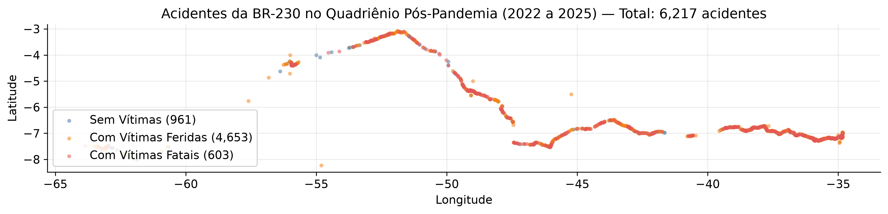
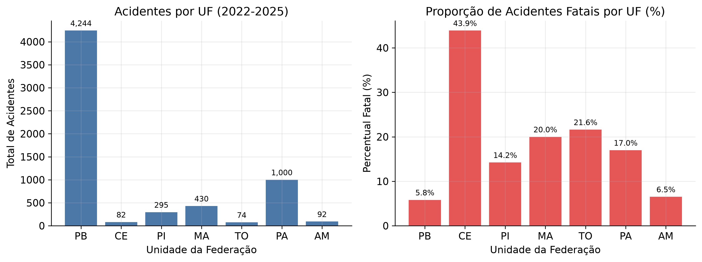
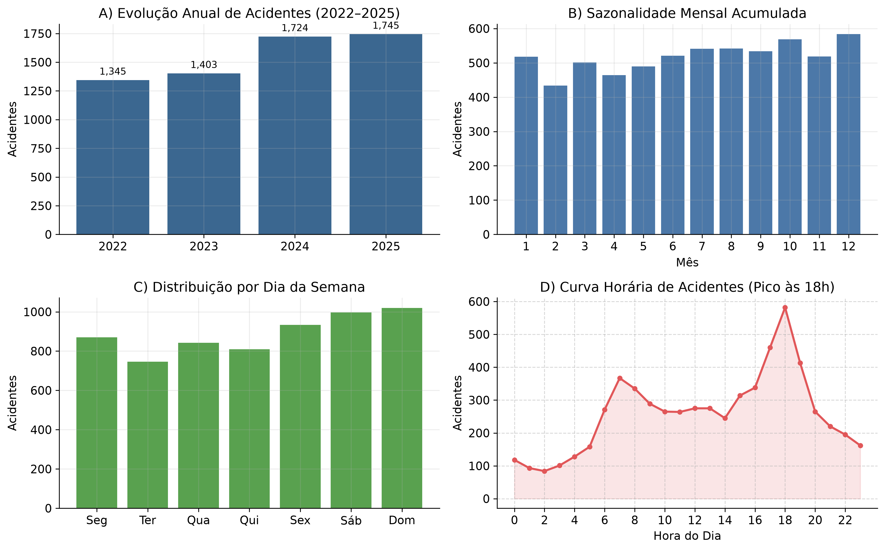
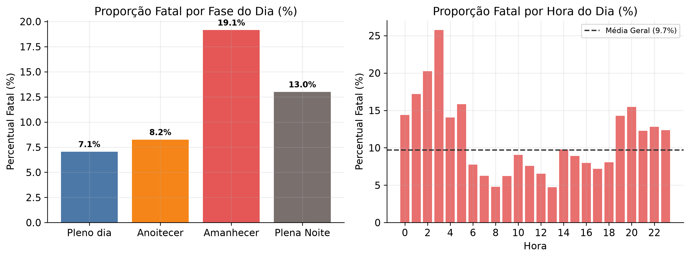
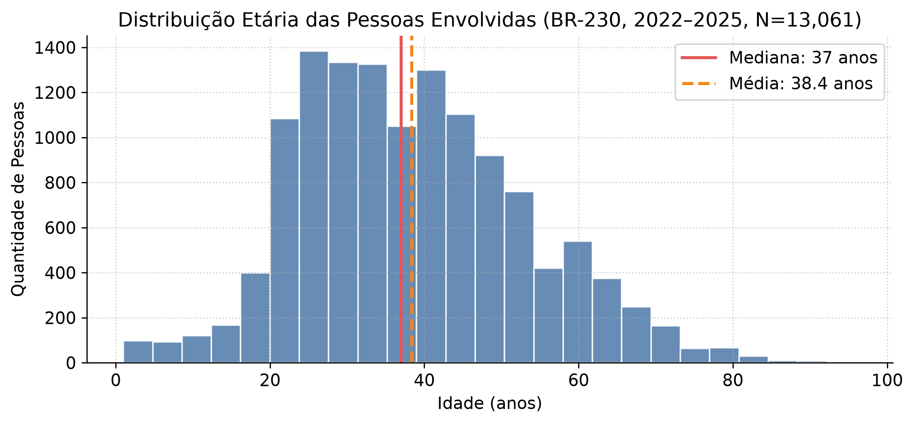

# Projeto da Disciplina Ciência de Dados
## Fase 2: Entendimento dos Dados (CRISP-DM)
### Relatório de Coleta, Descrição, Exploração e Avaliação da Qualidade dos Dados

**Projeto:** Mapa de Calor e Predição do Risco de Acidentes de Trânsito na BR-230  
**Instituição:** Universidade Federal do Maranhão (UFMA) — Programa de Pós-Graduação em Ciência da Computação (PPGCC)  
**Disciplina:** Ciência de Dados  
**Componentes:**
- João Batista Santos Silva Neto (`jbss.neto@discente.ufma.br`)
- Ricardo Diniz Mendes (`ricardo.dm@discente.ufma.br`)
- Winy Gabrielly Soares de Oliveira (`winy.soares@discente.ufma.br`)  
**Data de Emissão:** 13/10/2026  
**Versão do Documento:** 1.0  
**Status:** Concluído  

---

### Histórico de Revisões do Documento

| Revisão | Descrição | Modificado por | Status | Data |
| :---: | :--- | :---: | :---: | :---: |
| **1.0** | Elaboração completa do Relatório da Fase de Entendimento dos Dados (Coleta, Descrição, Exploração e Avaliação da Qualidade dos Dados), com análise do recorte da BR-230, catálogo de dados, dicionário com 41 variáveis, respostas às 5 questões analíticas e formulação de diretrizes para a Fase de Preparação. | Equipe do Projeto | Concluído | 13/10/2026 |

---

# 1 Coleta dos Dados

A tarefa de coleta inicial (*Collect initial data*) do processo CRISP-DM visa adquirir os dados listados nos recursos do projeto, registrar seus locais de armazenamento, documentar os métodos de acesso e extração, e relatar quaisquer dificuldades técnicas encontradas juntamente com as respectivas resoluções. Este esforço assegura a reprodutibilidade dos experimentos e estabelece as bases para o pipeline de preparação.

O projeto utiliza os registros públicos de acidentes da **Polícia Rodoviária Federal (PRF)** referentes ao ano de 2025. O portal de dados abertos da instituição disponibiliza três extrações estruturadas com diferentes granularidades (grãos), complementadas por fontes externas de validação institucional e geográfica: o **Anuário Estatístico 2025 da PRF** e os dados da malha rodoviária do **Departamento Nacional de Infraestrutura de Transportes (DNIT)**.

### Automação de Download e Reprodutibilidade da Série Pós-Pandemia (2022 a 2025)

Em atendimento às melhores práticas de reprodutibilidade científica e ao critério metodológico de contingência da Fase de Negócio, o projeto implementa um pipeline com **download e descompactação automatizados** diretamente a partir dos links oficiais do Portal de Dados Abertos da PRF (via Google Drive institucional). Caso os arquivos não existam localmente na pasta `bases/`, a rotina de carga executa a requisição, valida o hash/tamanho e descompacta o arquivo CSV sem exigir intervenção manual do pesquisador.

**Recorte Temporal Pós-Pandemia:**
Adotou-se o quadriênio **2022 a 2025** como universo de análise consolidada. Os anos de 2020 e 2021 foram descartados em virtude das anomalias severas de mobilidade urbana e rodoviária decorrentes das quarentenas, restrições sanitárias e interrupções logísticas da pandemia de COVID-19. A partir de 2022, o fluxo rodoviário retornou aos níveis regulares de demanda, conferindo validade temporal aos padrões observados.

| Ano | Acidentes (Brasil) | Acidentes (BR-230) | Vítimas Fatais (BR-230) | Acidentes Fatais (BR-230) | Proporção Fatais (%) |
| :---: | :---: | :---: | :---: | :---: | :---: |
| **2022** | 64.606 | 1.345 | 148 | 135 | 10,04% |
| **2023** | 67.766 | 1.403 | 160 | 143 | 10,19% |
| **2024** | 73.202 | 1.724 | 175 | 157 | 9,11% |
| **2025** | 72.529 | 1.745 | 192 | 168 | 9,63% |
| **Total (2022--2025)** | **278.103** | **6.217** | **675** | **603** | **9,70%** |

O uso do quadriênio pós-pandemia eleva o volume na BR-230 de 1.745 para **6.217 acidentes** e os acidentes com óbito de 168 para **603 casos**, conferindo significância estatística robusta aos estados de menor densidade (o Ceará atinge 82 acidentes, o Tocantins 74 e o Amazonas 92) e viabilizando a validação temporal prospectiva para Machine Learning (treinamento com 2022--2024 e teste com 2025).

### Catálogo Consolidado de Fontes de Dados (Tabela DATASETS)

A tabela a seguir consolida o catálogo das fontes de dados adquiridas para o projeto, documentando autor, identificação, formato, granularidade, dimensões, consumo em disco e papel desempenhado no fluxo analítico:

| Fonte / Autor | Arquivo / Dataset | Grão Amostral | Formato | Volume Bruto (Nacional) | Volume Recorte (BR-230) | Caminho / Acesso | Papel no Projeto |
| :--- | :--- | :--- | :---: | :---: | :---: | :--- | :--- |
| **Polícia Rodoviária Federal (PRF)** | `datatran2025.csv` | 1 linha = 1 acidente | CSV (`latin-1`, sep `;`) | 72.529 linhas × 30 colunas (21,1 MB) | 1.745 acidentes (2,41% do total nacional) | `bases/datatran2025.csv` / [Dados Abertos PRF](https://www.gov.br/prf/pt-br/acesso-a-informacao/dados-abertos/dados-abertos-da-prf) | Alimentação do Mapa de Calor, geolocalização exata, agregações temporais e desfecho de gravidade. |
| **Polícia Rodoviária Federal (PRF)** | `acidentes2025.csv` | 1 linha = 1 pessoa envolvida | CSV (`latin-1`, sep `;`) | 194.629 linhas × 35 colunas (72,8 MB) | 4.410 linhas de pessoas (4.297 pessoas reais) | `bases/acidentes2025.csv` / [Dados Abertos PRF](https://www.gov.br/prf/pt-br/acesso-a-informacao/dados-abertos/dados-abertos-da-prf) | Análise demográfica de vítimas, perfil de condutores, veículos e gravidade clínica das lesões. |
| **Polícia Rodoviária Federal (PRF)** | `acidentes2025_todas_causas_tipos.csv` | 1 linha = 1 pessoa × causa × tipo | CSV (`latin-1`, sep `;`) | 584.010 linhas × 37 colunas (~195 MB) | 18.255 linhas expandidas | Repositório Oficial PRF / Processado via *chunking* | Identificação de causas secundárias e multiplicidade de tipos de sinistros associados ao mesmo boletim. |
| **Polícia Rodoviária Federal (PRF)** | *Anuário Estatístico 2025* | Nível Rodovia / UF / País | PDF / Relatório Institucional | Estatísticas consolidadas de 2025 (Brasil) | Totais nacionais e estaduais de referência | Divulgação institucional (Maio/2026) / [Notícias PRF](https://www.gov.br/prf/pt-br/noticias/nacionais/2026/maio/prf-divulga-anuario-estatistico-de-2025-com-aumento-de-infracoes-e-reducao-de-mortes-nas-rodovias-federais) | Validação externa de fidelidade e exatidão dos totais calculados a partir dos dados locais. |
| **DNIT** | *Malha Rodoviária e Extensões* | Segmentos rodoviários | Especificação oficial | 4.260 km implantados (Cabedelo/PB a Lábrea/AM) | Extensões estaduais (PB: 521 km; TO: 144,7 km) | [Portal DNIT](https://www.gov.br/dnit/pt-br) | Validação do limite superior de quilometragem e delimitação geográfica dos trechos da rodovia. |

---

## 1.1 Fonte A: PRF — Acidentes Agrupados por Ocorrência (`datatran2025.csv`)

O arquivo `datatran2025.csv` constitui a base primária do projeto. Nele, cada registro representa um acidente de trânsito ocorrido em rodovia federal com boletim lavrado pela PRF em 2025.

- **Localização:** Diretório do projeto `bases/datatran2025.csv`.
- **Origem:** Portal Brasileiro de Dados Abertos e sítio oficial da PRF (<https://www.gov.br/prf/pt-br/acesso-a-informacao/dados-abertos/dados-abertos-da-prf>).
- **Método de Aquisição:** Download via protocolo HTTP direto a partir do portal governamental.
- **Estrutura e Dimensões:** Possui 72.529 linhas e 30 colunas, com tamanho em disco de aproximadamente 21,1 MB.
- **Grão Amostral:** 1 registro = 1 sinistro com identificador único `id`.
- **Uso no Projeto:** Utilizado diretamente na construção da malha espacial do **Mapa de Calor** (via coordenadas `latitude` e `longitude`), nas análises de concentração histórica por quilômetro e município, nos estudos de sazonalidade temporal (data, hora, dia da semana) e na definição do desfecho de gravidade (`classificacao_acidente`, contagem de mortos e feridos).

## 1.2 Fonte B: PRF — Acidentes Agrupados por Pessoa (`acidentes2025.csv`)

O arquivo `acidentes2025.csv` aprofunda a unidade de análise para os indivíduos envolvidos em cada sinistro rodoviário.

- **Localização:** Diretório `bases/acidentes2025.csv`.
- **Origem:** Portal de Dados Abertos da PRF.
- **Método de Aquisição:** Download direto via HTTP do pacote anual de 2025 agrupado por pessoa.
- **Estrutura e Dimensões:** Contém 194.629 linhas e 35 colunas, ocupando cerca de 72,8 MB em disco.
- **Grão Amostral:** 1 registro = 1 pessoa envolvida no sinistro (identificada por `pesid` dentro do `id` do acidente).
- **Uso no Projeto:** Caracterização demográfica (idade, sexo), categoria do envolvido (condutor, passageiro, pedestre), perfil dos veículos envolvidos (motocicleta, automóvel, caminhão, etc., com marca e ano de fabricação) e condição clínica das vítimas (`estado_fisico`).

## 1.3 Fonte C: PRF — Acidentes com Todas as Causas e Tipos (`acidentes2025_todas_causas_tipos.csv`)

Esta fonte expande a caracterização das circunstâncias do sinistro, registrando causas concorrentes e múltiplos tipos de impactos para uma mesma ocorrência.

- **Origem:** Portal de Dados Abertos da PRF.
- **Método de Aquisição:** Acesso à extração anual completa de 2025. Em virtude do tamanho elevado (~195 MB e mais de 584 mil linhas), a ingestão é realizada através de leitura em blocos (*chunksize* de 200.000 linhas) com filtragem dinâmica pelo critério `br == 230`.
- **Estrutura e Dimensões:** 584.010 linhas e 37 colunas na base nacional; 18.255 linhas expandidas referentes à BR-230.
- **Grão Amostral:** 1 registro = 1 pessoa × causa × tipo de acidente.
- **Uso no Projeto:** Identificação de causas secundárias e multiplicidade de tipos de sinistros. A análise revelou que 42,5% dos acidentes da BR-230 possuem mais de uma causa registrada e 65,5% possuem mais de um tipo de ocorrência. Quando filtrado para `causa_principal == 'Sim'` e `ordem_tipo_acidente == 1`, o conjunto colapsa perfeitamente para as 4.410 linhas do arquivo por pessoa, atestando a integridade do modelo relacional da PRF.

## 1.4 Fontes Externas e Complementares de Validação

Para assegurar a confiabilidade e veracidade dos dados locais, foram incorporadas duas referências oficiais de autoridade:
1. **Anuário Estatístico 2025 da PRF (divulgado em Maio de 2026):** Publicação oficial consolidada que divulga os totais anuais de sinistros (72.529), óbitos (6.043) e feridos (83.550) em rodovias federais, além dos volumes agregados para as rodovias BR-101, BR-116 e BR-040, e estados com maior volume (MG, SC e PR).
2. **Sistema de Informações Rodoviárias do DNIT:** Dados cadastrais da BR-230 (Rodovia Transamazônica), atestando a extensão implantada de cerca de 4.260 km entre Cabedelo (PB) e Lábrea (AM), e os limites de quilometragem por estado (ex.: 521,0 km na Paraíba e 144,7 km no Tocantins).

## 1.5 Problemas Encontrados na Coleta e Resoluções Técnicas

Durante o processo de ingestão e inspeção preliminar, foram diagnosticados e solucionados três problemas técnicos essenciais:

1. **Problema com Codificação de Caracteres (*Encoding*):** Os arquivos CSV da PRF utilizam codificação `ISO-8859-1` (`latin-1`), padrão no ecossistema governamental Windows. Tentativas de leitura com o padrão `UTF-8` resultam em falha de decodificação (`UnicodeDecodeError`).
   - *Resolução:* Configuração mandatória do parâmetro `encoding='latin-1'` no leitor Pandas (`pd.read_csv`), preservando acentuações e caracteres especiais nos nomes de municípios, causas e tipos.
2. **Problema de Delimitadores e Separador Numérico Decimal:** Os arquivos são exportados com ponto e vírgula (`;`) como separador de colunas e vírgula (`,`) como separador decimal para grandezas reais (coordenadas geográficas de latitude/longitude e marco quilométrico). A leitura desatenta converte campos de coordenadas em texto (*object*), inviabilizando operações espaciais.
   - *Resolução:* Definição explícita de `sep=';'` e `decimal=','` na rotina de leitura `ler_prf()`, garantindo que latitude, longitude e quilômetro sejam carregados diretamente como números de ponto flutuante de dupla precisão (`float64`).
3. **Problema de Explosão Granular e Consumo de Memória no Arquivo Expandido:** O arquivo de causas e tipos gera multiplicação de linhas por evento. Se carregado ingenuamente para cálculo de acidentes, inflacionaria o número de ocorrências na BR-230 de 1.745 para 18.255 registros.
   - *Resolução:* Implementação de processamento por blocos iterativos (*chunksize*) com extração isolada dos identificadores únicos e criação de um pipeline que utiliza exclusivamente `datatran2025.csv` para desenhar o mapa e contar ocorrências, reservando o arquivo expandido apenas para consultas circunstanciais de causas secundárias.

---

# 2 Descrição dos Dados

A tarefa de descrição dos dados (*Describe data*) investiga as propriedades brutas e de superfície dos dados adquiridos. Ela documenta o formato, o volume de registros e campos, a alocação de memória RAM, a delimitação temporal, a identidade das variáveis através de um dicionário formal e avalia se o acervo atende aos requisitos do projeto.

## 2.1 Embalagem e Propriedades de Superfície

A tabela a seguir resume a embalagem (*packaging*) dos dados carregados na memória do ambiente de análise:

| Arquivo Analisado | Registros (Linhas) | Campos (Colunas) | Acidentes Únicos (`id`) | Memória em RAM (MB) | Formato Físico |
| :--- | :---: | :---: | :---: | :---: | :---: |
| `datatran2025.csv` | 72.529 | 30 | 72.529 | 82,5 MB | Texto CSV (delimitador `;`) |
| `acidentes2025.csv` | 194.629 | 35 | 72.529 | 279,3 MB | Texto CSV (delimitador `;`) |
| `acidentes2025_todas_causas_tipos.csv` | 584.010 | 37 | 72.529 | ~750 MB (em streaming) | Texto CSV (delimitador `;`) |

O conjunto de dados apresenta uma correspondência perfeita de identificadores únicos entre as três fontes: todos os 72.529 acidentes registrados no arquivo de ocorrências encontram correspondência exata nos arquivos por pessoa e expandido, atestando a consistência do sistema de boletins da PRF.

## 2.2 Delimitação Temporal (Início e Fim da Base)

O intervalo temporal das ocorrências cobre o ano civil de 2025 na sua totalidade:
- **Data Inicial Observada:** `2025-01-01` (primeiro registro às 06:20:00).
- **Data Final Observada:** `2025-12-31` (último registro às 23:55:00).
- **Distribuição Mensal:** Há registros contínuos em todos os 12 meses do ano. Na escala nacional, o volume mensal oscila entre 5.287 (fevereiro) e 6.788 (dezembro). No recorte da BR-230, as ocorrências distribuem-se estavelmente entre 120 e 160 acidentes mensais.

## 2.3 Grão e Relacionamento de Integridade entre as Fontes

A correta interpretação do modelo depende da distinção rigorosa da unidade amostral:
1. **Grão Ocorrência (`datatran2025.csv`):** Cada linha representa um acidente único. É o único arquivo adequado para desenhar o **Mapa de Calor** e calcular taxas de acidentes, pois não contém linhas duplicadas.
2. **Grão Pessoa (`acidentes2025.csv`):** Cada linha representa um envolvido. As colunas `mortos`, `feridos_leves`, `feridos_graves` e `ilesos` funcionam como variáveis indicadoras binárias (0 ou 1) atribuídas àquela pessoa específica. Quando essas variáveis são somadas e agrupadas por `id`, o valor reproduz exatamente as contagens das colunas de mesmo nome em `datatran2025.csv`.
3. **Grão Causas/Tipos (`acidentes2025_todas_causas_tipos.csv`):** Cada linha representa a combinação de uma pessoa, uma causa e um tipo. A filtragem por `causa_principal == 'Sim'` e `ordem_tipo_acidente == 1` restaura perfeitamente o grão de pessoa.

## 2.4 Dicionário de Dados Consolidado

Abaixo é apresentado o dicionário de dados formal contemplando as 41 variáveis presentes nas fontes da PRF:

| Nome do Campo | Tipo Primitivo | Descrição Semântica / Negócio | Grão / Arquivo | Domínio / Exemplo |
| :--- | :---: | :--- | :--- | :--- |
| `id` | Inteiro (`int64`) | Identificador único numérico da ocorrência do acidente. | Ocorrência e Pessoa | Ex: 652493 |
| `pesid` | Inteiro (`int64`) | Identificador único da pessoa envolvida. O valor 0 indica pessoa não identificada. | Pessoa e Expandido | Ex: 1459203 (0 = sentinela) |
| `data_inversa` | Texto/Data (`str`) | Data do sinistro no formato `AAAA-MM-DD`. | Ocorrência | `2025-01-01` a `2025-12-31` |
| `dia_semana` | Categórico (`str`) | Dia da semana da ocorrência por extenso. | Ocorrência | segunda-feira a domingo |
| `horario` | Texto/Hora (`str`) | Hora da ocorrência no formato `HH:MM:SS`. | Ocorrência | `00:00:00` a `23:59:59` |
| `uf` | Categórico (`str`) | Sigla da Unidade Federativa onde ocorreu o sinistro. | Ocorrência | PB, PA, MA, PI, AM, CE, TO |
| `br` | Inteiro (`int64`) | Número identificador da rodovia federal. | Ocorrência | 230 (recorte do projeto) |
| `km` | Real (`float64`) | Marco quilométrico do sinistro (recomeça a contagem dentro de cada UF). | Ocorrência | 0,0 a 1.230,0 km |
| `municipio` | Categórico (`str`) | Nome do município onde o acidente aconteceu. | Ocorrência | JOAO PESSOA, MARABA, etc. |
| `causa_acidente` | Categórico (`str`) | Causa registrada pelo policial (causa principal em `datatran`). | Ocorrência e Expandido | Ausência de reação do condutor, etc. |
| `tipo_acidente` | Categórico (`str`) | Dinâmica principal do acidente (ordem 1 em `datatran`). | Ocorrência e Expandido | Colisão traseira, Tombamento, etc. |
| `classificacao_acidente` | Categórico (`str`) | Gravidade do acidente: Sem Vítimas, Com Vítimas Feridas ou Com Vítimas Fatais. | Ocorrência | Sem Vítimas, Feridas, Fatais |
| `fase_dia` | Categórico (`str`) | Período de luminosidade natural no momento do sinistro. | Ocorrência | Pleno dia, Plena Noite, Anoitecer, Amanhecer |
| `sentido_via` | Categórico (`str`) | Direção de deslocamento conforme a quilometragem da via. | Ocorrência | Crescente, Decrescente, Não Informado |
| `condicao_metereologica`| Categórico (`str`) | Condição do tempo registrada na lavratura do boletim. | Ocorrência | Céu Claro, Nublado, Chuva, Sol, etc. |
| `tipo_pista` | Categórico (`str`) | Configuração estrutural da via. | Ocorrência | Simples, Dupla, Múltipla |
| `tracado_via` | Categórico (`str`) | Geometria do leito carroçável (pode conter valores compostos separados por `;`). | Ocorrência | Reta, Curva, Reta;Declive, etc. |
| `uso_solo` | Categórico (`str`) | Ambiente circundante: 'Sim' para área urbana, 'Não' para área rural. | Ocorrência | Sim (Urbano), Não (Rural) |
| `pessoas` | Inteiro (`int64`) | Quantidade total de pessoas envolvidas no acidente. | Ocorrência | 1 a 76 pessoas |
| `mortos` | Inteiro (`int64`) | Quantidade total de vítimas fatais no acidente (ou indicador 0/1 no arquivo pessoa). | Ocorrência / Pessoa | 0 a 10 óbitos |
| `feridos_leves` | Inteiro (`int64`) | Quantidade de vítimas com lesões leves (ou indicador 0/1 no arquivo pessoa). | Ocorrência / Pessoa | 0 a 30 feridos |
| `feridos_graves` | Inteiro (`int64`) | Quantidade de vítimas com lesões graves (ou indicador 0/1 no arquivo pessoa). | Ocorrência / Pessoa | 0 a 20 feridos |
| `ilesos` | Inteiro (`int64`) | Quantidade de pessoas sem lesões físicas (ou indicador 0/1 no arquivo pessoa). | Ocorrência / Pessoa | 0 a 70 pessoas |
| `ignorados` | Inteiro (`int64`) | Quantidade de pessoas cujo estado físico não foi determinado. | Ocorrência | 0 a 25 pessoas |
| `feridos` | Inteiro (`int64`) | Soma aritmética de feridos leves e graves. | Ocorrência | 0 a 45 feridos |
| `veiculos` | Inteiro (`int64`) | Quantidade total de veículos automotores envolvidos. | Ocorrência | 1 a 15 veículos |
| `latitude` | Real (`float64`) | Coordenada geográfica em graus decimais (formato WGS84). | Ocorrência | [-2,32 a -9,75] na BR-230 |
| `longitude` | Real (`float64`) | Coordenada geográfica em graus decimais (formato WGS84). | Ocorrência | [-34,83 a -64,95] na BR-230 |
| `regional` | Categórico (`str`) | Superintendência da PRF responsável pela circunscrição policial. | Ocorrência | SPRF-PB, SPRF-PA, SPRF-MA, etc. |
| `delegacia` | Categórico (`str`) | Unidade de Delegacia da PRF circunscricionada. | Ocorrência | DEL01-PB, DEL02-PA, etc. |
| `uop` | Categórico (`str`) | Unidade Operacional Policial da PRF. | Ocorrência | UOP01-PB, etc. |
| `id_veiculo` | Inteiro (`int64`) | Identificador do veículo vinculado à pessoa. | Pessoa | Inteiro positivo |
| `tipo_veiculo` | Categórico (`str`) | Categoria regulamentar do veículo do envolvido. | Pessoa | Motocicleta, Automóvel, Caminhão, etc. |
| `marca` | Categórico (`str`) | Fabricante e modelo comercial do veículo. | Pessoa | HONDA, VW, FIAT, etc. |
| `ano_fabricacao_veiculo`| Inteiro (`int64`)| Ano fabril do automóvel (o valor 0 opera como ausência). | Pessoa | 1950 a 2026 (0 = sentinela) |
| `tipo_envolvido` | Categórico (`str`) | Função exercida pelo indivíduo no evento. | Pessoa | Condutor, Passageiro, Pedestre, etc. |
| `estado_fisico` | Categórico (`str`) | Gravidade clínica constatada no atendimento policial. | Pessoa | Ileso, Lesões Leves, Lesões Graves, Óbito |
| `idade` | Inteiro (`int64`) | Idade do indivíduo em anos completos (0 opera como sentinela). | Pessoa | 1 a 100 anos (0 e >100 anômalos) |
| `sexo` | Categórico (`str`) | Sexo biológico declarado ou identificado. | Pessoa | Masculino, Feminino, Não Informado |
| `causa_principal` | Categórico (`str`) | Flag indicando se a causa foi determinante ('Sim' ou 'Não'). | Expandido | Sim, Não |
| `ordem_tipo_acidente` | Inteiro (`int64`) | Hierarquia sequencial do tipo de impacto (1 = impacto primário). | Expandido | 1 a 6 |

## 2.5 Resumo Estatístico de Superfície

### Variáveis Numéricas (Escala Nacional vs. Recorte da BR-230)

A tabela abaixo exibe a distribuição univariada dos atributos contínuos e discretos na escala nacional (72.529 acidentes) e no recorte específico da BR-230 (1.745 acidentes):

| Atributo Numérico | Média (BR-230) | Desvio Padrão (BR-230) | Mínimo (BR-230) | 1º Quartil (25%) | Mediana (50%) | 3º Quartil (75%) | Máximo (BR-230) | Média Nacional |
| :--- | :---: | :---: | :---: | :---: | :---: | :---: | :---: | :---: |
| `km` | 179,9 km | 240,6 km | 0,0 km | 25,0 km | 78,0 km | 231,0 km | 1.230,0 km | 260,0 km |
| `pessoas` | 2,46 | 1,82 | 1,00 | 2,00 | 2,00 | 3,00 | 45,00 | 2,60 |
| `veiculos` | 1,67 | 0,81 | 1,00 | 1,00 | 2,00 | 2,00 | 11,00 | 1,74 |
| `mortos` | 0,110 | 0,39 | 0,00 | 0,00 | 0,00 | 0,00 | 4,00 | 0,083 |
| `feridos_leves` | 0,79 | 1,05 | 0,00 | 0,00 | 1,00 | 1,00 | 25,00 | 0,80 |
| `feridos_graves` | 0,35 | 0,68 | 0,00 | 0,00 | 0,00 | 1,00 | 7,00 | 0,35 |
| `ilesos` | 0,91 | 1,32 | 0,00 | 0,00 | 1,00 | 1,00 | 40,00 | 1,08 |
| `latitude` | -6,71° | 1,94° | -9,75° | -7,21° | -7,09° | -7,04° | -2,32° | - |
| `longitude` | -40,32° | 7,85° | -64,95° | -35,88° | -35,32° | -34,88° | -34,83° | - |

A mediana do quilômetro na BR-230 é de 78,0 km (com 25% dos casos situados até o km 25), demonstrando a alta concentração das ocorrências nos primeiros trechos da rodovia (em especial no litoral paraibano). A taxa média de óbitos por sinistro na BR-230 (0,110 mortes/acidente) é 32,5% superior à média nacional das rodovias federais (0,083 mortes/acidente), confirmando a severidade crítica da Rodovia Transamazônica.

### Variáveis Categóricas (Recorte BR-230: 1.745 acidentes)

- **Classificação de Gravidade:** Com Vítimas Feridas (1.329 casos; 76,16%), Sem Vítimas (248 casos; 14,21%) e Com Vítimas Fatais (168 casos; 9,63%).
- **Fase do Dia:** Pleno Dia (941 casos; 53,9%), Plena Noite (634 casos; 36,3%), Anoitecer (103 casos; 5,9%) e Amanhecer (67 casos; 3,8%).
- **Condição Meteorológica:** Céu Claro (1.236 casos; 70,8%), Nublado (243 casos; 13,9%), Chuva (145 casos; 8,3%), Sol (68 casos; 3,9%), Garoa/Chuvisco (41 casos; 2,3%) e Ignorado/Nevoeiro (12 casos; 0,7%).
- **Tipo de Pista:** Pista Simples (854 casos; 48,9%), Pista Dupla (826 casos; 47,3%) e Pista Múltipla (65 casos; 3,7%).
- **Uso do Solo:** Área Urbana (`Sim`: 988 casos; 56,6%) vs. Área Rural (`Não`: 757 casos; 43,4%).
- **Sentido da Via:** Crescente (909 casos; 52,1%) e Decrescente (836 casos; 47,9%).

## 2.6 Avaliação do Atendimento aos Requisitos do Projeto

Confrontando os dados adquiridos com os requisitos especificados na Fase 1 (*Entendimento do Negócio*):
- **Requisito de Representação Espacial:** 100% dos acidentes da BR-230 possuem pares de coordenadas (`latitude` e `longitude`) válidos e pertencentes ao território brasileiro, atendendo com excelência aos requisitos para a modelagem por Kernel Density Estimation (KDE) e visualização do **Mapa de Calor**.
- **Requisito de Informações Temporais e Circunstanciais:** Data, horário, dia da semana, fase do dia, clima, geometria da via e uso do solo apresentam preenchimento pleno, viabilizando o perfilamento de risco temporal e ambiental.
- **Requisito de Definição da Variável-Alvo Preditiva:** A coluna `classificacao_acidente` e as variáveis contínuas de óbitos/lesões oferecem suporte objetivo para a formulação da variável-alvo supervisionada. Constatou-se, todavia, um desbalanceamento severo da classe fatal (9,6% dos casos), o que exige salvaguardas metodológicas imediatas na fase de preparação e modelagem.

---

# 3 Exploração dos Dados

A tarefa de exploração dos dados (*Explore data*) utiliza consultas estatísticas, técnicas de visualização e agregações multidimensionais para responder às questões analíticas que orientam as metas do CRISP-DM.

---

## 3.1 Questão 1: Concentração e Distribuição Espacial ao longo da BR-230 (Alimentação do Mapa de Calor)

*Os registros da PRF de 2025 cobrem adequadamente a BR-230 no espaço geográfico? Em quais estados, municípios e trechos quilométricos os acidentes se concentram?*

O corredor da BR-230 (Rodovia Transamazônica) estende-se da costa da Paraíba até o estado do Amazonas. No ano de 2025, os dados registram ocorrências em **7 Unidades da Federação** e **93 municípios distintos**.

### Distribuição de Acidentes e Gravidade por Unidade da Federação na BR-230

| UF | Acidentes | Participação (%) | Mortos | Feridos | Feridos Graves | Pessoas Envolvidas | Km Mínimo | Km Máximo | Municípios | Proporção Fatais (%) |
| :---: | :---: | :---: | :---: | :---: | :---: | :---: | :---: | :---: | :---: | :---: |
| **PB** | 1.191 | 68,25% | 75 | 1.400 | 396 | 2.836 | 0,5 km | 516,0 km | 41 | 5,46% |
| **PA** | 280 | 16,05% | 55 | 305 | 92 | 772 | 2,0 km | 1.230,0 km | 16 | 16,79% |
| **MA** | 119 | 6,82% | 24 | 118 | 55 | 301 | 0,0 km | 570,0 km | 14 | 18,49% |
| **PI** | 88 | 5,04% | 16 | 82 | 42 | 192 | 0,0 km | 310,4 km | 7 | 15,91% |
| **AM** | 24 | 1,38% | 0 | 22 | 6 | 51 | 314,8 km | 687,0 km | 4 | 0,00% |
| **CE** | 22 | 1,26% | 13 | 19 | 13 | 57 | 2,2 km | 113,0 km | 4 | 54,55% |
| **TO** | 21 | 1,20% | 9 | 49 | 8 | 88 | 1,8 km | 144,0 km | 7 | 38,10% |
| **Total** | **1.745** | **100,0%** | **192** | **1.995** | **612** | **4.297** | - | - | **93** | **9,63%** |

### Concentração por Faixas Quilométricas (Janelas de 50 km)

A análise espacial em janelas de 50 km revela um padrão de hiperconcentração:
1. **Faixa km 0 a 50 na Paraíba:** Concentra **649 acidentes** (37,2% de toda a BR-230 no país e 54,5% do estado da Paraíba), abrangendo os municípios de Cabedelo, João Pessoa e Santa Rita. A proporção de acidentes fatais nesta faixa é de apenas **3,39%** (22 óbitos), reflexo de uma infraestrutura urbana de pista dupla com maior tráfego, lentidão e fiscalização eletrônica.
2. **Faixa km 50 em diante na Paraíba:** Reúne 542 acidentes, com taxa de letalidade subindo para **7,93%** (53 óbitos) à medida que a rodovia avança para o agreste e sertão (Campina Grande, Patos, Sousa, Cajazeiras).
3. **Faixa km 100 no Pará:** Reúne 132 acidentes (eixo Marabá–Itupiranga), com proporção de fatalidades de **9,09%** (12 mortos).

**Conclusão Espacial:** A viabilidade do **Mapa de Calor** é plena. O mapa destacará com forte intensidade visual o litoral paraibano (alta densidade de eventos com baixa severidade) e núcleos urbanos do Pará e Maranhão, enquanto trechos remotos do Ceará e Tocantins apresentarão baixa densidade, mas com elevadíssimo índice de óbito por sinistro.

---

## 3.2 Questão 2: Padrões Temporais dos Acidentes (Sazonalidade, Dias e Horários)

*Quando os acidentes acontecem? Os períodos com maior volume de colisões coincidem com os momentos de maior gravidade?*

### Sazonalidade Mensal
O volume mensal de acidentes na BR-230 ao longo de 2025 apresenta grande estabilidade: janeiro (131), fevereiro (127), março (144), abril (139), maio (147), junho (147), julho (150), agosto (150), setembro (145), outubro (150), novembro (149) e dezembro (166). Não se observa um mês isolado com pico desproporcional, demonstrando que a rodovia opera sob demanda contínua de tráfego.

### Dia da Semana e Letalidade

| Dia da Semana | Acidentes | Participação (%) | Proporção Fatais (%) | Mortos |
| :--- | :---: | :---: | :---: | :---: |
| Segunda-feira | 241 | 13,81% | 9,54% | 32 |
| Terça-feira | 244 | 13,98% | 6,56% | 18 |
| Quarta-feira | 244 | 13,98% | 9,43% | 27 |
| Quinta-feira | 190 | 10,89% | 7,89% | 16 |
| Sexta-feira | 259 | 14,84% | 6,95% | 23 |
| Sábado | 292 | 16,73% | 10,96% | 32 |
| **Domingo** | **285** | **16,33%** | **15,44%** | **44** |

Os registros elevam-se consideravelmente a partir de sexta-feira, culminando no sábado e no domingo (que somam juntos 33,1% das ocorrências). O **domingo** é o dia de maior criticidade: concentra a maior proporção de acidentes fatais (**15,44%**) e o maior número absoluto de mortes (**44 óbitos**), indicando forte influência do lazer, excesso de velocidade e consumo de bebidas alcoólicas.

### Ciclo Horário e Fase do Dia

| Fase do Dia | Acidentes | Proporção do Volume (%) | Proporção de Fatais (%) | Mortos |
| :--- | :---: | :---: | :---: | :---: |
| Pleno Dia | 941 | 53,93% | 7,01% | 74 |
| **Plena Noite** | 634 | 36,33% | **12,78%** | **87** |
| Anoitecer | 103 | 5,90% | 5,83% | 7 |
| **Amanhecer** | 67 | 3,84% | **11,94%** | **11** |

O ciclo horário registra pico de ocorrências entre as 17:00 e 19:00 (com máxima às 18:00 reunindo 145 acidentes), momento que coincide com a saída de trabalhadores e fluxo pendular. Em contrapartida, a **taxa de mortalidade** é quase o dobro durante a **Plena Noite (12,78%)** e no **Amanhecer (11,94%)**, evidenciando que menor tráfego associado à escuridão e fadiga favorece colisões em velocidades mais severas.

---

## 3.3 Questão 3: Influência das Características da Via, Geometria e Condições Meteorológicas

*Quais condições de infraestrutura e do ambiente meteorológico estão associadas à ocorrência de sinistros e ao aumento da gravidade?*

### Condição Meteorológica
O clima predominante nos boletins é de **Céu Claro** (1.236 acidentes; 70,8%), seguido por **Nublado** (243 casos; 13,9%) e **Chuva** (145 casos; 8,3%). Curiosamente, a proporção fatal em céu claro (**9,0%**) é superior à observada sob chuva (**6,9%**). Isso ocorre porque sob pista molhada e precipitação os motoristas reduzem a velocidade média, diminuindo a probabilidade de impacto fatal.

### Tipo de Pista e Uso do Solo

| Tipo de Pista | Acidentes | Proporção (%) | Mortos | Proporção Fatais (%) |
| :--- | :---: | :---: | :---: | :---: |
| **Simples** | 854 | 48,94% | 146 | **14,52%** |
| **Dupla** | 826 | 47,34% | 42 | **4,84%** |
| **Múltipla** | 65 | 3,72% | 4 | **3,08%** |

O volume de acidentes divide-se quase igualmente entre pista simples e pista dupla. Todavia, a **pista simples** concentra **76,0% de todas as mortes da rodovia** (146 dos 192 óbitos), com uma taxa de fatalidade três vezes maior do que a pista dupla (14,52% vs. 4,84%).
No que tange ao ambiente, a **Área Urbana** concentra 56,6% dos acidentes (988 casos; 6,0% fatais), enquanto a **Área Rural** responde por 43,4% (757 casos; **14,4% fatais** e 131 mortes).

### Geometria da Via
Acidentes em traçado de **Reta** totalizam 934 ocorrências isoladas, enquanto **Curvas** somam 131 casos. A análise identificou **536 ocorrências com traçado composto** na mesma célula (ex.: `Reta;Aclive`, `Reta;Declive`), exigindo padronização e desdobramento categórico na fase de preparação.

---

## 3.4 Questão 4: Análise da Gravidade e Definição da Variável-Alvo Preditiva

*Onde os acidentes ocorrem com maior gravidade? As variáveis contextuais distinguem trechos de alto volume de trechos de alta letalidade? Como estruturar a variável-alvo preditiva?*

A constatação analítica mais profunda da Fase 2 é a **dissociação entre concentração de acidentes e gravidade do desfecho**:
- Onde há maior volume de acidentes (Paraíba, trecho metropolitano, pista dupla, urbano), a taxa de fatalidade é mínima (3,4%).
- Onde os acidentes são menos volumosos (Norte/Nordeste interiorano, pista simples, área rural), a taxa de fatalidade atinge níveis alarmantes.

### Tabela Cruzada: Uso do Solo × Tipo de Pista (Gravidade Bivariada)

| Recorte Territorial | Uso do Solo | Tipo de Pista | Acidentes | Proporção Fatais (%) | Mortos |
| :--- | :---: | :---: | :---: | :---: | :---: |
| **BR-230 Completa** | Urbano (`Sim`) | Pista Dupla | 576 | 4,69% | 27 |
| **BR-230 Completa** | Urbano (`Sim`) | Pista Simples | 359 | 8,64% | 31 |
| **BR-230 Completa** | Rural (`Não`) | Pista Dupla | 250 | 5,20% | 15 |
| **BR-230 Completa** | **Rural (`Não`)** | **Pista Simples** | **495** | **19,00%** | **114** |
| *Excluindo a Paraíba* | Rural (`Não`) | Pista Dupla | 9 | 0,00% | 0 |
| *Excluindo a Paraíba* | Urbano (`Sim`) | Pista Dupla | 96 | 9,38% | 9 |
| *Excluindo a Paraíba* | Urbano (`Sim`) | Pista Simples | 157 | 14,01% | 23 |
| *Excluindo a Paraíba* | **Rural (`Não`)** | **Pista Simples** | **291** | **24,74%** | **85** |

Quando se exclui o trecho duplicado da Paraíba, o segmento **Rural em Pista Simples** apresenta **24,74% de acidentes com mortes** (1 em cada 4 acidentes resulta em óbito). No Ceará, esse valor atinge 52,63% e no Tocantins 38,10%.

### Formulação da Variável-Alvo para o Componente Preditivo

Para o desenvolvimento do modelo preditivo supervisionado, estabelece-se como variável-alvo a gravidade intrínseca da ocorrência:
- **Definição Operacional da Classe Positiva:** Acidente classificado como `Com Vítimas Fatais` (`mortos > 0`), representando a classe crítica de risco extremo. Alternativamente, na modelagem, pode-se avaliar o agrupamento de acidentes graves (`Com Vítimas Fatais` + `Feridos Graves`).
- **Desbalanceamento de Classes:** Dos 1.745 acidentes, apenas **168 são fatais (9,63%)** contra **1.577 não-fatais (90,37%)**. Essa distribuição severamente desbalanceada (~1 positivo para cada 9,4 negativos) impõe a necessidade de reamostragem, ajuste de custos de classificação (*class weights*) e adoção de métricas apropriadas como ROC-AUC, PR-AUC, F1-macro e Acurácia Balanceada.

---

## 3.5 Questão 5: Causas Principais, Tipos de Sinistros e Perfil de Envolvidos e Veículos

*Quais fatores causais e modalidades de colisão predominam? Quem são as vítimas mais afetadas e quais veículos participam dos sinistros?*

### Causas Determinantes
As falhas humanas e comportamentais dominam os boletins:
1. **Ausência de reação do condutor:** 345 acidentes (19,77%).
2. **Reação tardia ou ineficiente do condutor:** 232 acidentes (13,30%).
3. **Acessar a via sem observar a presença de outros veículos:** 168 acidentes (9,63%).
4. **Condutor deixou de manter distância segura:** 128 acidentes (7,34%).
5. **Ingestão de álcool pelo condutor:** 101 acidentes (5,79%).
6. Manobra de mudança de faixa indevida (91), Transitar na contramão (77), Falhas mecânicas/elétricas (64), Animais na pista (59), Velocidade incompatível (48) e Condutor dormindo (33).

### Tipos de Acidentes
1. **Colisão traseira:** 377 acidentes (21,60%).
2. **Tombamento:** 234 acidentes (13,41%).
3. **Colisão transversal:** 230 acidentes (13,18%).
4. **Saída de leito carroçável:** 201 acidentes (11,52%).
5. **Colisão frontal:** 128 acidentes (7,34%) — modalidade responsável pela maior letalidade relativa em pista simples.

### Perfil dos Envolvidos e Veículos (Grão Pessoa — 4.410 registros na BR-230)
- **Tipo de Envolvido:** Condutores representam a grande maioria dos registros identificados (**2.915; 65,9%**), seguidos por Passageiros (1.069; 24,2%), Testemunhas (85) e Pedestres (76).
- **Gênero:** Predomínio expressivo do sexo Masculino (**2.840; 75,6%** dos válidos) frente ao Feminino (915; 24,4%).
- **Faixa Etária:** Entre os registros com idade informada válida (1 a 91 anos), a média é de **38,4 anos** e a mediana é de **37,0 anos** (1º quartil: 27 anos; 3º quartil: 48 anos), situando a maior incidência na faixa economicamente ativa.
- **Tipo de Veículo:** **Motocicletas** lideram com **1.321 registros (36,1%)**, seguidas de perto por **Automóveis (1.271; 34,8%)**, Caminhonetes (422; 11,5%), Semirreboques (219), Caminhões (216) e Ônibus (178). A altíssima participação de motocicletas explica a alta taxa de ferimentos graves e óbitos na região.

---

# 4 Qualidade dos Dados

A tarefa de verificação da qualidade (*Verify data quality*) avalia se a base cobre todos os casos requeridos, detecta erros, ruídos e inconsistências lógicas, quantifica e rastreia os valores ausentes e formaliza a matriz de decisões e encaminhamentos para a etapa de Preparação dos Dados (*Data Preparation*).

---

## 4.1 Completude dos Dados

- **Completude Espacial e Temporal da BR-230:** A base de acidentes da PRF de 2025 cobre com 100% de completude as coordenadas geográficas (`latitude` e `longitude`), o quilômetro da via, a data e a classificação de gravidade para todos os 1.745 registros da BR-230.
- **Limitação de Amostragem em Trechos Remotos:** Em estados como Ceará (22 acidentes), Tocantins (21 acidentes) e Amazonas (24 acidentes), a baixa contagem em 2025 decorre da baixa densidade de tráfego e trechos de difícil fiscalização. Municípios como Lábrea (AM), extremo oeste da rodovia, não possuem registros de acidentes no ano, o que reflete a ausência de sinistros comunicados e não uma falha de extração.
- **Limitação Estrutural de Escopo (Ausência de Dados de Exposição):** A base da PRF é composta estritamente por *ocorrências consumadas* (numerador do risco). Ela não inclui contagens de fluxo de tráfego (Volume Médio Diário — VMD) nem gera registros de "não-acidentes" para trechos e horários seguros. Assim, os modelos probabilísticos desenvolvidos representarão o **risco condicional à ocorrência de um acidente** (probabilidade de severidade fatal dado que o acidente ocorreu), complementando o **Mapa de Calor** que estima a densidade espacial das ocorrências.

## 4.2 Correção e Identificação de Erros Lógicos

A investigação detalhada revelou anomalias que exigem tratamento na Fase 3:
1. **Identificador Sentinela `pesid = 0`:** Constatou-se a existência de **263 linhas com `pesid = 0`** na BR-230. Trata-se de um código sentinela utilizado pela PRF para registrar indivíduos não identificados (como condutores evadidos ou vítimas sem documentação). Como o mesmo `pesid = 0` é atribuído a diferentes pessoas em um mesmo acidente, isso gerava a falsa impressão de linhas duplicadas (113 linhas além do número de pessoas distintas). O valor 0 deve ser tratado como ausência de ID pessoal.
2. **Idades e Anos de Fabricação Sentinela:** Foram identificadas **753 linhas com `idade = 0`** e **567 linhas com `ano_fabricacao_veiculo = 0`**. Ambos operam como códigos de omissão de informação e não valores numéricos reais. Além disso, identificou-se um registro com idade de 914 anos (erro grosseiro de digitação).
3. **Discrepância na Soma de Envolvidos:** Em 65 acidentes na BR-230, a soma de `mortos + feridos_leves + feridos_graves + ilesos + ignorados` diverge sutilmente da coluna `pessoas`. A coluna `pessoas` deve ser adotada como contagem de referência primária por coincidir com a contagem de registros no arquivo por pessoa.
4. **Divergência Administrativa vs. Geográfica:** Em 34 acidentes, a Unidade Federativa do município onde ocorreu o sinistro difere da UF da Superintendência Regional da PRF responsável pelo boletim. O caso mais frequente ocorre na divisa entre Maranhão e Piauí (municípios maranhenses da BR-230 atendidos pela SPRF-PI). Para a confecção do mapa e análise geoespacial, as coordenadas geográficas e a UF do município prevalecem de forma soberana sobre a circunscrição administrativa.
5. **Traçados Compostos de Pista:** O campo `tracado_via` possui **536 registros** contendo múltiplos valores separados por ponto e vírgula na mesma célula (ex.: `Reta;Aclive`).

## 4.3 Valores Ausentes

A tabela a seguir consolida a taxa de incompletude e valores ausentes (*missing values*) nas três fontes:

| Arquivo | Atributo | Quantidade Nula / Percentual | Diagnóstico e Impacto no Projeto |
| :--- | :--- | :---: | :--- |
| `datatran2025.csv` | `uop` | 38 ausências (0,05% nacional) | Metadado administrativo policial; sem impacto analítico. |
| `datatran2025.csv` | `delegacia` | 22 ausências (0,03% nacional) | Metadado administrativo policial; sem impacto analítico. |
| `datatran2025.csv` | `regional` | 2 ausências (<0,01% nacional) | Metadado administrativo policial; sem impacto analítico. |
| `datatran2025.csv` | `classificacao_acidente` | 1 ausência (0 na BR-230) | Na BR-230 a completude é de 100,0%. |
| `datatran2025.csv` | `latitude`, `longitude`, `km` | 0 ausências na BR-230 (100% preenchidos) | Excelente cobertura espacial; nenhum registro da BR-230 é descartado por falta de coordenada. |
| `acidentes2025.csv` | `tipo_envolvido`, `estado_fisico`, `sexo` | 8,81% de nulos na base nacional | Decorre de vítimas não identificadas ou que evadiram do local. |
| `acidentes2025.csv` | `tipo_veiculo` | 3,26% de nulos na base nacional | Ocorrências com pedestres/animais ou veículos não identificados. |
| `expandidos` | `idade` | 18,08% de nulos na base nacional | Exige imputação robusta ou exclusão de modelos específicos de condutor. |
| `expandidos` | `pesid` | 9,73% de nulos na base nacional | Pessoas sem identificação formal. |

## 4.4 Validação Externa dos Dados

Para garantir a higidez e a consistência científica dos dados manipulados, realizou-se a validação cruzada externa confrontando os totais calculados no ambiente analítico contra fontes oficiais externas.

### Confronto com o Anuário Estatístico 2025 da PRF

| Indicador de Controle | Valor no Anuário Oficial PRF 2025 | Total Calculado na Base Local | Status da Validação |
| :--- | :---: | :---: | :---: |
| **Total Nacional de Sinistros em 2025** | 72.529 | 72.529 | **Conferência Exata (100%)** |
| **Total Nacional de Vítimas Fatais (Óbitos)** | 6.043 | 6.043 | **Conferência Exata (100%)** |
| **Total Nacional de Feridos** | 83.550 | 83.550 | **Conferência Exata (100%)** |
| **Sinistros na Rodovia BR-101** | 13.014 | 13.014 | **Conferência Exata (100%)** |
| **Sinistros na Rodovia BR-116** | 11.021 | 11.021 | **Conferência Exata (100%)** |
| **Sinistros na Rodovia BR-040** | 3.502 | 3.502 | **Conferência Exata (100%)** |
| **Sinistros no Estado de Minas Gerais** | 9.570 | 9.570 | **Conferência Exata (100%)** |
| **Sinistros no Estado de Santa Catarina** | 8.186 | 8.186 | **Conferência Exata (100%)** |
| **Sinistros no Estado do Paraná** | 7.630 | 7.630 | **Conferência Exata (100%)** |

A igualdade estrita em todos os 9 indicadores atesta que o arquivo `datatran2025.csv` utilizado no projeto é a extração consolidada e definitiva do fechamento de 2025 da PRF.

### Confronto com a Infraestrutura Rodoviária do DNIT
- **Limite Quilométrico da Paraíba:** O maior quilômetro registrado com acidente na PB é o **km 516,0**, valor perfeitamente compatível e contido no limite oficial publicado pelo DNIT de **521,0 km** para o trecho paraibano.
- **Limite Quilométrico do Tocantins:** O maior quilômetro com acidente no TO é o **km 144,0**, contido na extensão oficial do trecho tocantinense de **144,7 km**.

---

## 4.5 Matriz de Encaminhamentos e Decisões para a Fase 3 (Preparação dos Dados)

A tabela abaixo estabelece as decisões técnicas obrigatórias a serem implementadas no pipeline da Fase 3 (*Data Preparation*), conectando os diagnósticos de qualidade aos objetivos de negócio:

| Decisão Técnica para a Fase 3 | Justificativa Metodológica | Tratamento / Implementação no Pipeline |
| :--- | :--- | :--- |
| **1. Utilizar `datatran2025.csv` como base do Mapa de Calor e modelo primário** | Cada linha representa exatamente um acidente, com 100% de coordenadas preenchidas. | Filtrar `br == 230` mantendo a unidade de análise de ocorrência única. |
| **2. Utilizar `acidentes2025.csv` apenas para agregação de vítimas e veículos** | O grão é o indivíduo. Somar flags binárias por `id` evita duplicação de acidentes. | Criar atributos agregados por acidente (ex.: `% de motocicletas`, `presença de pedestre`). |
| **3. Posicionamento geográfico estritamente por (`latitude`, `longitude`)** | O quilômetro (`km`) recomeça a contagem dentro de cada estado da federação. | Utilizar coordenadas WGS84 para agrupamento espacial e densidade Kernel (KDE). |
| **4. Tratar `pesid = 0`, `idade = 0` e `ano_fabricacao_veiculo = 0` como valores ausentes (`NaN`)** | Representam valores sentinela de omissão e não valores numéricos reais. | Substituir zeros sentinela por `NaN` e aplicar imputação por mediana ou categoria específica. |
| **5. Desmembrar o atributo `tracado_via` com valores compostos** | 536 registros possuem traçados combinados por ponto e vírgula (`Reta;Declive`). | Criar variáveis *dummy* ou selecionar a primeira geometria como predominante. |
| **6. Preservar as coordenadas e UF do município em casos de divergência administrativa** | Em 34 registros a regional administrativa difere do local geográfico do fato. | A localização física do sinistro sobrepõe-se à jurisdição policial para fins de mapeamento. |
| **7. Estruturar tratamento especializado para o desbalanceamento da classe fatal** | Apenas 9,63% dos sinistros da BR-230 resultaram em mortes (168 de 1.745). | Adotar pesos balanceados (*class_weight='balanced'*), técnicas de *oversampling* (SMOTE) e métricas PR-AUC / F1-Score. |
| **8. Modelar a probabilidade condicional de risco** | A base não contém volumes de veículos em trânsito (não-acidentes). | O modelo prediz a severidade condicional ao acidente ocorrido; o mapa expressa a concentração espacial. |

---

# 5 Referências

1. **Chapman, P., Clinton, J., Kerber, R., Khabaza, T., Reinartz, T., Shearer, C., & Wirth, R.** (2000). *CRISP-DM 1.0: Step-by-step data mining guide*. CRISP-DM Consortium.
2. **Polícia Rodoviária Federal (PRF).** (2026). *Dados Abertos da PRF: Acidentes de Trânsito*. Ministério da Justiça e Segurança Pública. Disponível em: <https://www.gov.br/prf/pt-br/acesso-a-informacao/dados-abertos/dados-abertos-da-prf>.
3. **Polícia Rodoviária Federal (PRF).** (2026). *Dicionário de Dados de Acidentes de Trânsito*. Disponível em: <https://www.gov.br/prf/pt-br/acesso-a-informacao/dados-abertos/dicionario-acidentes>.
4. **Polícia Rodoviária Federal (PRF).** (2026). *Anuário Estatístico 2025 da Polícia Rodoviária Federal*. Divulgado em Maio de 2026. Disponível em: <https://www.gov.br/prf/pt-br/noticias/nacionais/2026/maio/prf-divulga-anuario-estatistico-de-2025-com-aumento-de-infracoes-e-reducao-de-mortes-nas-rodovias-federais>.
5. **Departamento Nacional de Infraestrutura de Transportes (DNIT).** (2026). *Informações Rodoviárias e Extensões da Rodovia BR-230*. Ministério dos Transportes. Disponível em: <https://www.gov.br/dnit/pt-br>.
6. **Behboudi, L., et al.** (2024). *Machine Learning and Spatial Analysis for Road Traffic Accident Prediction*. Journal of Safety Research.
7. **Santos, D., et al.** (2021). *Spatial analysis and accident hotspot identification on federal highways*. Transportation Research Interdisciplinary Perspectives.
8. **Tozetto, R., et al.** (2025). *Spatio-temporal modeling of traffic crashes using open federal highway data in Brazil*. Accident Analysis & Prevention.
